# 💻 Portfólio

> Portfólio profissional em formato de **editor de código**: cada seção do site é um arquivo e os projetos aparecem em uma timeline vertical, como um histórico de commits.

<p align="center"></p>

---

## 🚧 Status do Projeto


---

## 📚 Índice
- [Links Úteis](#-links-úteis)
- [Sobre o Projeto](#-sobre-o-projeto)
- [Funcionalidades Principais](#-funcionalidades-principais)
- [Tecnologias Utilizadas](#-tecnologias-utilizadas)
- [Arquitetura](#-arquitetura)
- [Instalação e Execução](#-instalação-e-execução)
- [Deploy](#-deploy)
- [Estrutura de Pastas](#-estrutura-de-pastas)
- [Demonstração](#-demonstração)
- [Documentações utilizadas](#-documentações-utilizadas)
- [Autores](#-autores)

---

## 🔗 Links Úteis
* 🌐 **Site publicado:** [Acesse o portfólio](https://portfolio-profissional-five-sigma.vercel.app/)
* 🎨 **Protótipos no Figma:** [Ver wireframes](https://www.figma.com/design/M14F6SjfmMztR2751UTDP9/Wireframe-Portf%C3%B3lio?node-id=0-1&t=8WGaRr0sx56Vhz5W-1)
  > Wireframes de média fidelidade (desktop e mobile).
* 📦 **Repositório:** [GitHub](https://github.com/bernardorf5/Portfolio-Profissional)

---

## 📝 Sobre o Projeto

Este projeto é o meu **portfólio profissional**, desenvolvido no Laboratório 01 da disciplina de Desenvolvimento e Integração de Aplicações Web (DIAW), do curso de Engenharia de Software da PUC Minas.

O objetivo é apresentar minha trajetória, habilidades, projetos e formas de contato de maneira moderna e acessível. Em vez de uma página tradicional, o site simula um **editor de código**: o visitante navega por arquivos (`Sobremim.md`, `Projetos.md`, `Experiencia.md` e `Contato.md`) e acompanha a timeline de projetos como se fosse um histórico de commits. O site foi pensado para ser lido e navegado com mouse, toque ou teclado.

---

## ✨ Funcionalidades Principais

📁 **Navegação estilo editor:** explorador de arquivos lateral, aba do arquivo aberto, breadcrumb e barra de status (linha/coluna, espaços, codificação e tipo de arquivo).
🌐 **Português e inglês:** alternância de idioma (PT/EN) pela barra de status, com o idioma ativo destacado. Os textos e também os nomes dos arquivos são traduzidos (`Sobremim.md` vira `Aboutme.md`).
🕒 **Timeline de projetos:** Timeline com nome, descrição, tecnologias, link do GitHub e imagem em cada projeto.
💼 **Experiências:** empresa/instituição, cargo ou atividade, período e breve descrição.
✉️ **Contato:** ícones clicáveis (e-mail, WhatsApp, LinkedIn e GitHub) e formulário com nome, e-mail e mensagem, com envio por e-mail e validações básicas.
📱 **Design responsivo:** layout adaptado para desktop e celular.
♿ **Acessibilidade:** navegação por teclado (arquivos e idioma são botões com foco visível).

---

## 🛠 Tecnologias Utilizadas

As versões exatas ficam registradas no `package.json`.

### 💻 Front-end

* **Biblioteca:** React
* **Linguagem:** JavaScript (ES6+)
* **Build Tool:** Vite
* **Estilização:** CSS puro

### ☁️ Serviços e ferramentas

* **Envio de e-mail (formulário de contato):** EmailJS
* **Hospedagem:** Vercel
* **Protótipos e wireframes:** Figma
* **Versionamento:** Git e GitHub

### 📦 Dependências principais

| Pacote | Para quê |
| :--- | :--- |
| `react` e `react-dom` | Construção da interface com componentes |
| `vite` | Servidor de desenvolvimento e build |
| `@emailjs/browser` | Envio do formulário de contato por e-mail |
| `eslint` e plugins (`react-hooks`, `react-refresh`) | Análise estática do código (`npm run lint`) |
| `@vitejs/plugin-react` | Integração do React com o Vite |

### 📜 Scripts disponíveis

| Comando | O que faz |
| :--- | :--- |
| `npm run dev` | Inicia o servidor de desenvolvimento |
| `npm run build` | Gera a versão de produção em `/dist` |
| `npm run preview` | Simula a produção localmente |
| `npm run lint` | Executa o ESLint |

---

## 🏗 Arquitetura

Aplicação **front-end (SPA)** sem back-end próprio. A interface é dividida em componentes que imitam as partes de um editor de código.

**Principais componentes:**

- **TitleBar:** barra superior com a logo e o título do site.
- **Explorer:** lista de arquivos (as seções do portfólio).
- **Tabs:** aba do arquivo aberto.
- **Editor:** área central que exibe o breadcrumb e o conteúdo do arquivo selecionado.
- **FormularioContato:** formulário da página de contato, com validação e envio via EmailJS.
- **Icone:** ícones SVG (e-mail, WhatsApp, LinkedIn e GitHub) usados nos canais de contato.
- **StatusBar:** barra inferior com as informações do arquivo e o seletor de idioma (PT/EN).

**Decisões de projeto:**

- Os dados (arquivos, contatos, projetos, experiências e textos em PT/EN) ficam em arquivos separados do código dos componentes. Cada texto traduzido é um objeto com as chaves `pt` e `en`, então o componente só escolhe `texto[idioma]`.
- O estado da interface (arquivo aberto e idioma) é controlado pelo React no `App.jsx` e repassado aos componentes por props.
- As imagens dos projetos ficam em `public/projetos/` e são acessadas pelo caminho `/projetos/arquivo.png`.

---

## 🔧 Instalação e Execução

### Pré-requisitos

* **Node.js:** versão LTS (v20.19 ou superior)
* **Gerenciador de pacotes:** npm

### Variáveis de Ambiente

Crie um arquivo `.env.local` na raiz do projeto (ele **não** deve ser versionado). Use o `.env.example` como referência. No Vite, as variáveis precisam começar com `VITE_`.

| Variável | Descrição |
| :--- | :--- |
| `VITE_EMAILJS_SERVICE_ID` | ID do serviço configurado no EmailJS |
| `VITE_EMAILJS_TEMPLATE_ID` | ID do template de e-mail |
| `VITE_EMAILJS_PUBLIC_KEY` | Chave pública do EmailJS |

### Instalação de Dependências

```bash
git clone https://github.com/bernardorf5/Portfolio-Profissional.git
cd Portfolio-Profissional
npm install
```

### Como Executar

```bash
npm run dev
```

🎨 *O site estará disponível em **http://localhost:5173** (ou na porta indicada pelo Vite).*

### Build de produção

```bash
npm run build     # gera a pasta /dist
npm run preview   # simula a produção localmente
```

---

## 🚀 Deploy

O site é publicado gratuitamente na **Vercel**, com atualização automática a cada push na branch principal.

1. Envie o projeto para o GitHub.
2. Na Vercel, importe o repositório (**Add New > Project**).
3. Confirme o preset **Vite** (comando de build `npm run build`, pasta de saída `dist`).
4. Cadastre as variáveis `VITE_EMAILJS_*` em **Settings > Environment Variables**.
5. Clique em **Deploy**. O link gerado está na seção [Links Úteis](#-links-úteis).

---

## 📂 Estrutura de Pastas

```
.
├── README.md                # 📘 Documentação principal
├── .gitignore               # 🧹 Arquivos ignorados pelo Git (node_modules, .env.local, dist)
├── .env.example             # 🧩 Exemplo das variáveis de ambiente (sem valores reais)
├── index.html               # 📄 Página base (título e ícone da aba)
├── package.json             # 📦 Dependências e scripts
├── package-lock.json        # 🔒 Versões exatas das dependências
├── vite.config.js           # ⚙️ Configuração do Vite
├── eslint.config.js         # 🧪 Regras do ESLint
│
├── /public
│   ├── logo.svg             # 🔷 Ícone da aba do navegador
│   └── /projetos            # 🖼️ Imagens e GIFs da timeline de projetos
├── /docs
│   ├── logo.svg             # 🔷 Logo usada neste README
│   ├── /prototipos          # 🎨 Imagens dos wireframes
│   └── /site                # 📸 Prints do site publicado
│       ├── /desktop         #    Versão desktop (PT e EN)
│       └── /mobile          #    Versão mobile (PT e EN)
│
└── /src
    ├── main.jsx             # 🚪 Ponto de entrada da aplicação
    ├── App.jsx              # 🧱 Layout principal e estado (arquivo aberto e idioma)
    ├── index.css            # 🎨 Estilos globais
    ├── /assets              # 🖼️ Logo utilizada no código
        └── logo.svg        
    ├── /components          # 🧱 Editor, Explorer, FormularioContato, Icone, StatusBar, Tabs, TitleBar
        ├── Editor.jsx
        ├── Explorer.jsx
        ├── FormularioContato.jsx
        ├── Icone.jsx
        ├── StatusBar.jsx
        ├── Tabs.jsx
        └── TitleBar.jsx         
    ├── /pages               # 📄 Conteúdo de cada arquivo: Contato, Experiência, Projetos, SobreMim
        ├── Contato.jsx
        ├── Experiencia.jsx
        ├── Projetos.jsx
        └── SobreMim.jsx
    ├── /data                # 🗂️ Dados de: Arquivos, Contatos, Experiências e Projetos
        ├── arquivos.js
        ├── contatos.js
        ├── experiencias.js
        └── projetos.js
    └── /i18n                # 🌐 Textos em português e inglês
        └── textos.js               
```

---

## 🎥 Demonstração

### 🌐 Site em funcionamento

| Português (PT) | Inglês (EN) |
| :---: | :---: |
| 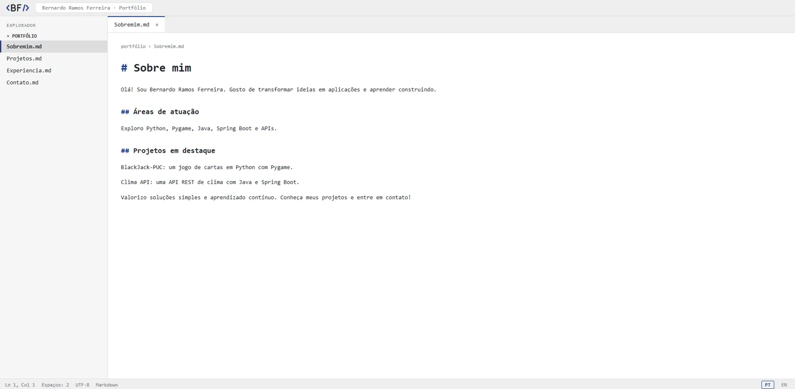 | 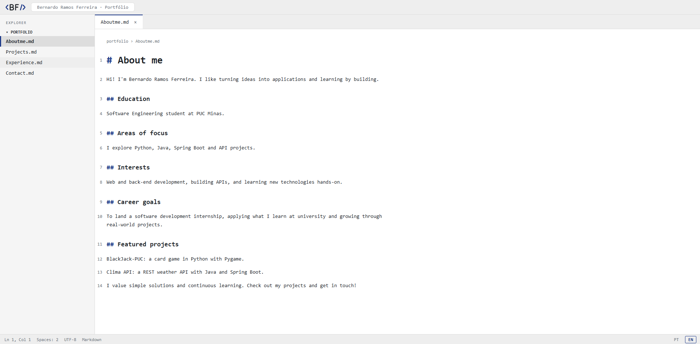 |
| **Projetos** | **Projects** |
| 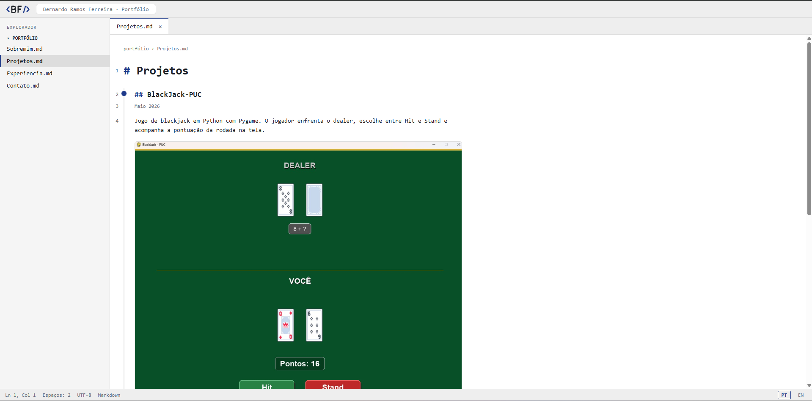 | 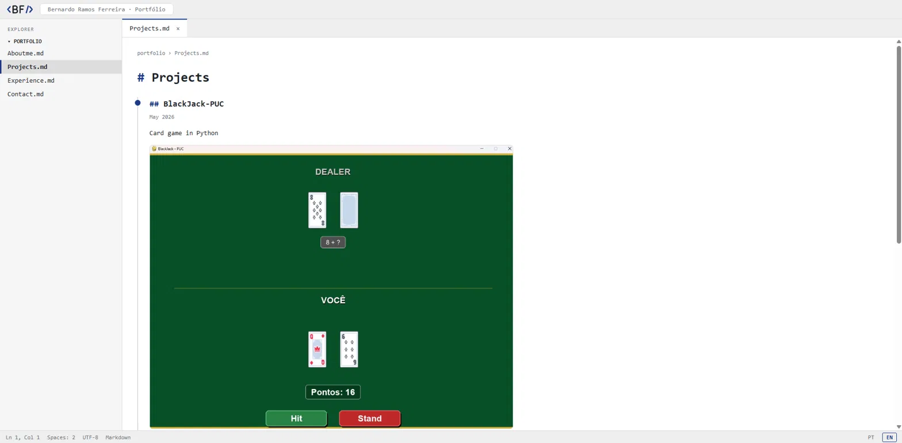 |
| **Experiências** | **Experiences** |
| 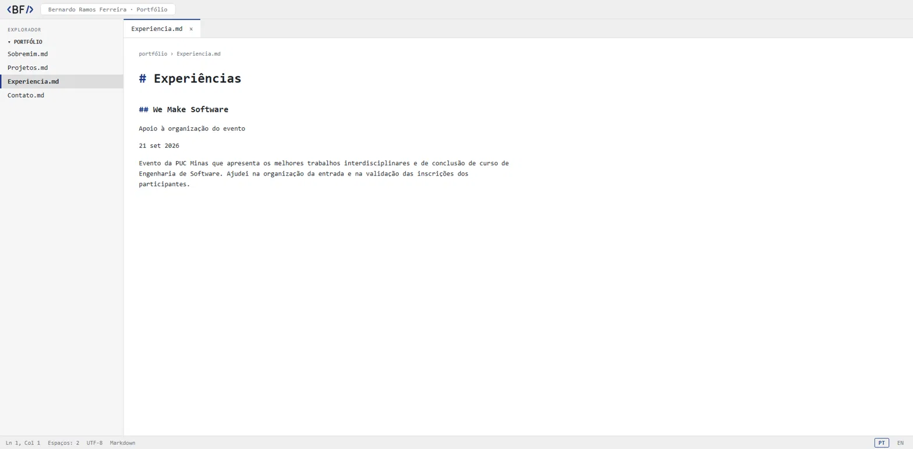 | 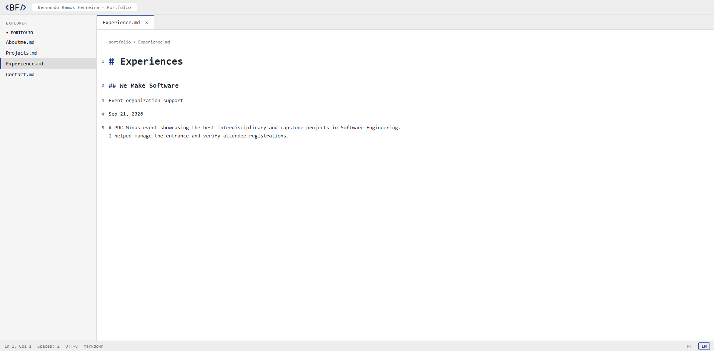 |
| **Contato** | **Contact** |
| 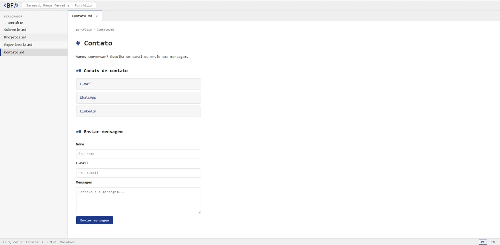 | 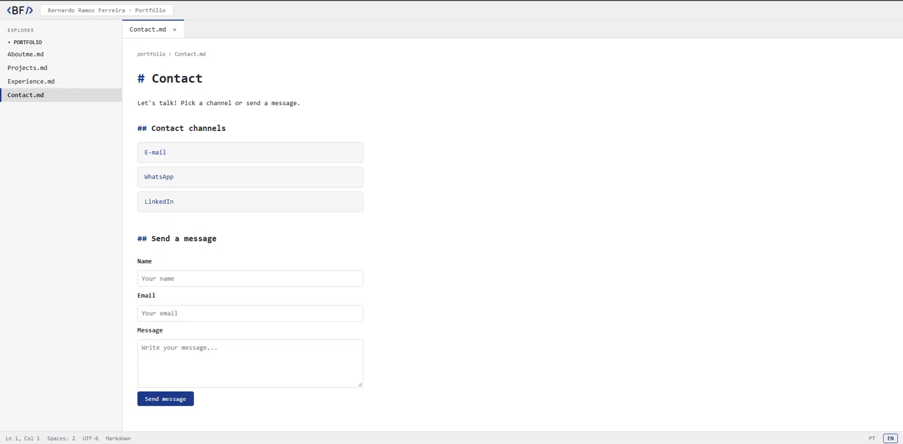 |

#### 📱 Versão mobile

No celular, o explorador de arquivos vira uma barra de abas rolável na horizontal, acima do arquivo aberto.

| Sobre mim | Projetos | Experiências | Contato |
| :---: | :---: | :---: | :---: |
| 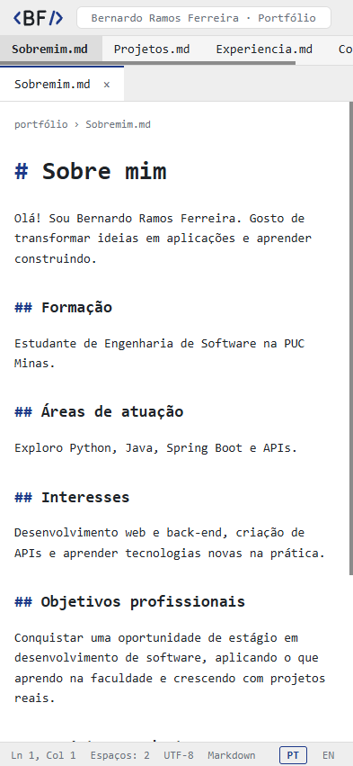 | 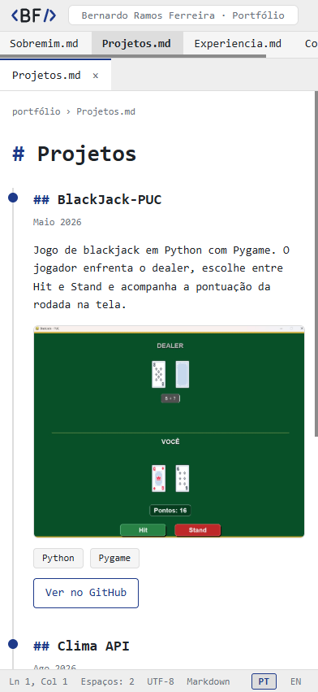 | 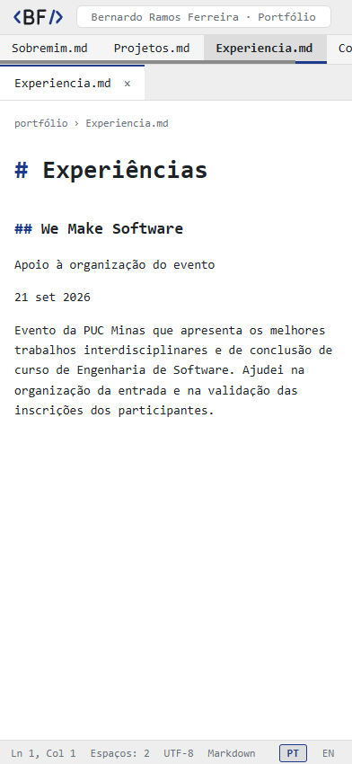 | 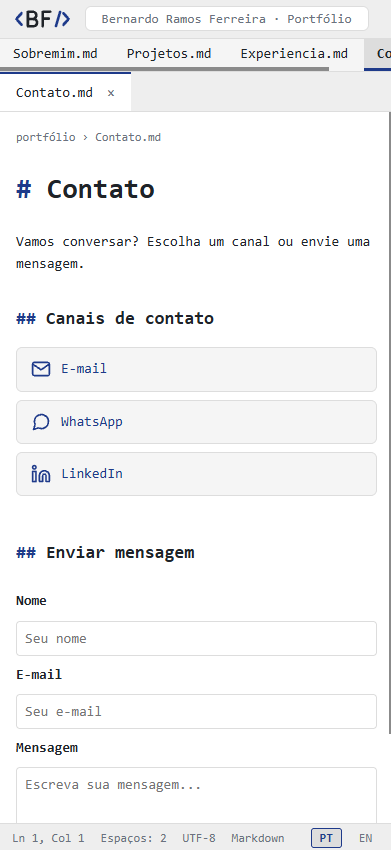 |
| **About me** | **Projects** | **Experiences** | **Contact** |
| 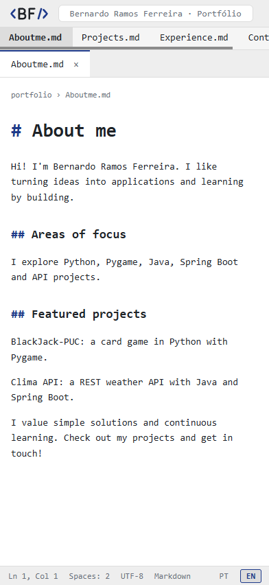 | 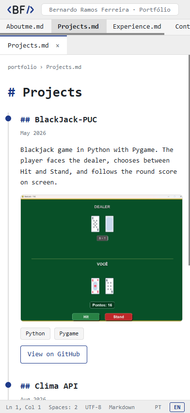 | 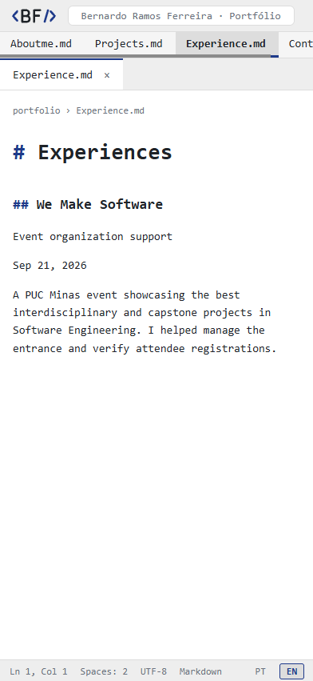 | 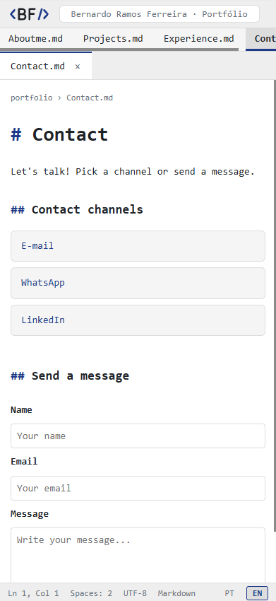 |

### 🎨 Protótipos (Sprint 1)

Wireframes de média fidelidade feitos no Figma. O protótipo previa um terminal integrado e alguns detalhes de estilização, que ficaram fora da versão final para priorizar as seções obrigatórias.

#### 💻 Desktop

| Sobre mim | Projetos |
| :---: | :---: |
| 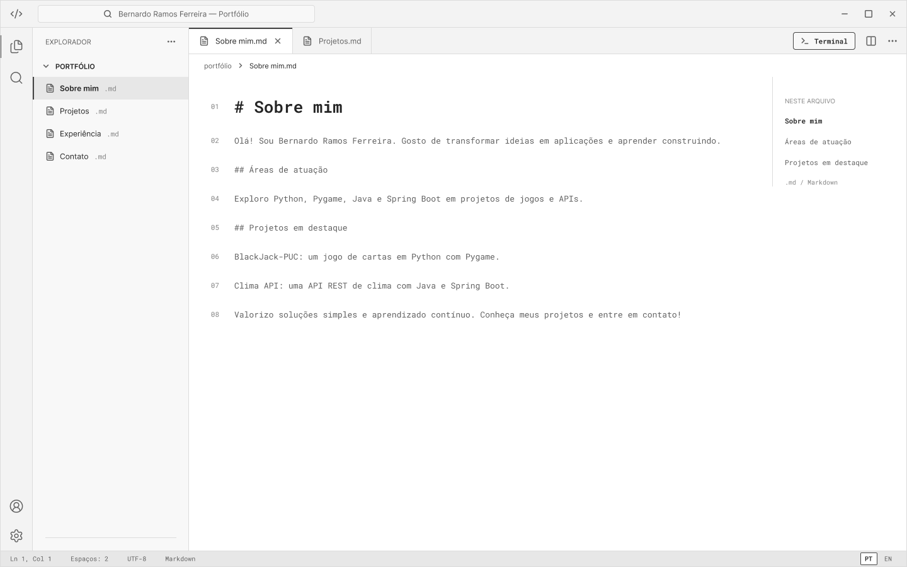 | 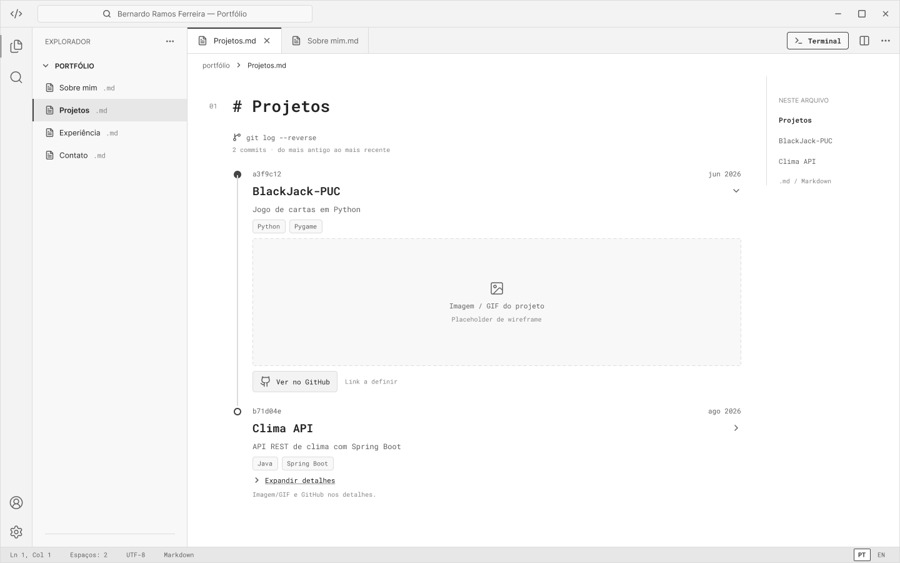 |
| **Contato** | **Terminal aberto** |
| 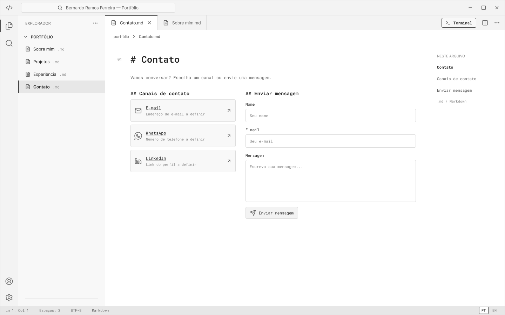 | 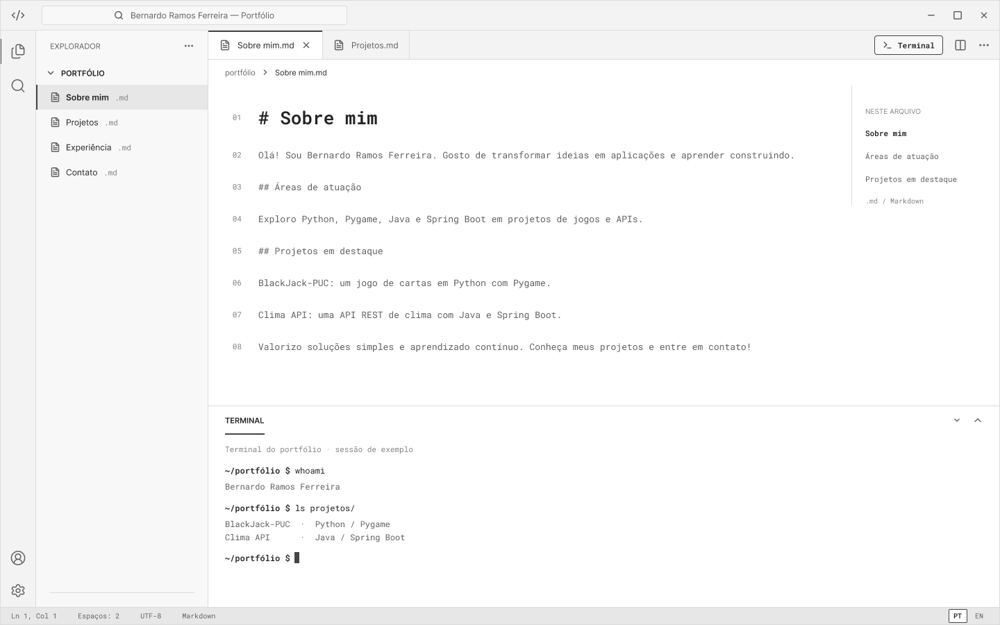 |

#### 📱 Mobile

| Sobre mim | Projetos | Contato | Terminal aberto |
| :---: | :---: | :---: | :---: |
| 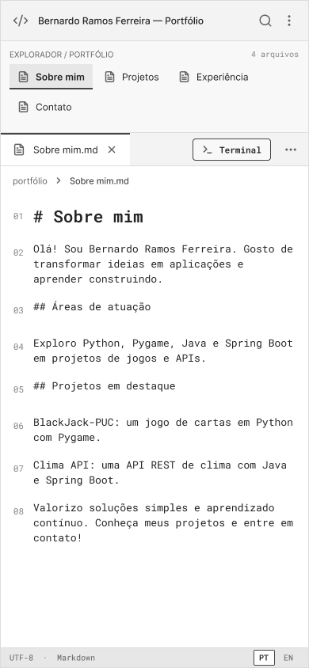 | 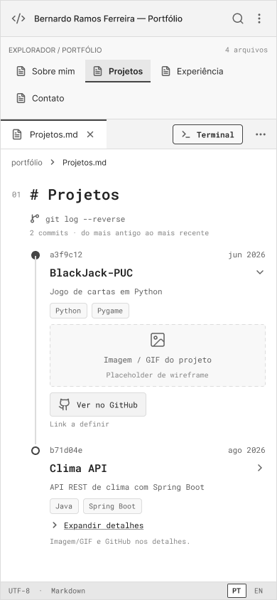 | 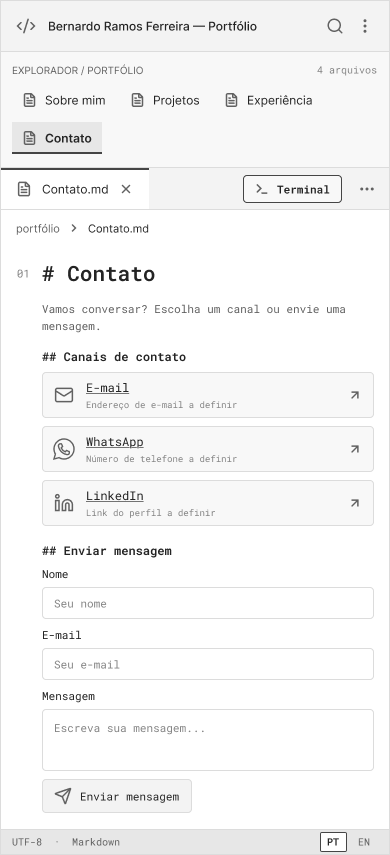 | 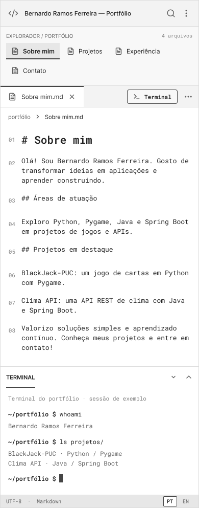 |

---

## 🔗 Documentações utilizadas

* 📖 **React:** [react.dev](https://react.dev/)
* 📖 **Vite:** [vitejs.dev](https://vitejs.dev/)
* 📖 **EmailJS:** [Documentação oficial](https://www.emailjs.com/docs/)
* 📖 **Vercel:** [Documentação oficial](https://vercel.com/docs)
* 📖 **Figma:** [figma.com](https://www.figma.com/)

---

## 👥 Autores

| 👤 Nome | |  |  |
|---------|------------------|-------------|-----------|
| Bernardo Ramos Ferreira | [GitHub](https://github.com/bernardorf5) | [LinkedIn](https://www.linkedin.com/in/bernardoramosferreira) | [E-mail](mailto:bernardoramosf22@gmail.com) |

---